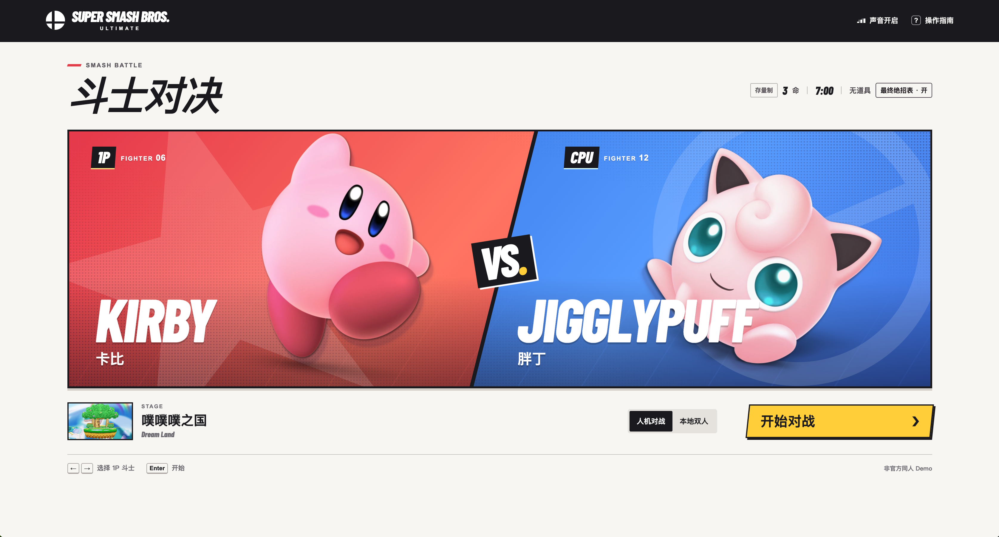

# 大乱斗 · 卡比对胖丁



一款以卡比与胖丁为主角的浏览器平台格斗同人 Demo。在噗噗噗之国（Dream Land）的舞台上，选择你的斗士，与电脑切磋，或和朋友来一场本地双人对决。

累积伤害、抓住破绽，用一记猛击将对手送出场外！

## 游戏特色

- **两位斗士，各有绝招**：卡比的吸入与复制、锤子、最终斩刀、石头；胖丁的滚动、拍击、唱歌与睡觉。
- **平台格斗玩法**：普通攻击、空中攻击、蓄力猛击、护盾、闪避、精准防御、抓取与四方向投掷，以及崖边恢复动作。
- **最终绝招**：可开关最终绝招表，蓄满后发动卡比的究极连环剑或胖丁的巨大化。
- **人机与本地双人**：默认三条命、七分钟、无道具，支持同一设备上的双人对战。
- **多种输入方式**：键盘、手柄与触屏操作，内置中文操作指南。
- **画面与反馈**：Three.js 角色与舞台渲染，配合受击停顿、击飞烟轨、战斗音效和终结演出。
- **离线可玩**：构建后的 `index.html` 内嵌脚本与资源，无需安装 npm 依赖。

## 开始游玩

下载仓库后，直接用支持 WebGL 的现代浏览器打开 `index.html`，选择角色与模式，点击“开始对战”。声音会在与页面交互后启用。

也可以通过本地静态服务运行：

```bash
python3 -m http.server 8000
```

在浏览器访问 `http://localhost:8000`。本地双人使用同一设备，不包含网络联机。

## 键盘操作

| 动作 | 1P | 2P |
| --- | --- | --- |
| 移动 / 方向 | W A S D | 方向键 |
| 步行 | 左 Shift + A / D | 右 Ctrl + ← / → |
| 跳跃 / 空中再跳 | 空格 | Enter |
| 普通攻击 | J | , |
| 必杀技 | K | . |
| 蓄力猛击 | L | / |
| 护盾 | U | 右 Shift |
| 抓取 / 投掷 | I | ' |
| 挑衅 / 卡比解除复制 | T | ] |
| 暂停 | Esc | Esc |

配合方向键可切换攻击与必杀技；抓住对手后按攻击进行拍打，按方向进行投掷。最终绝招表蓄满后，松开方向并按必杀键发动。更多手柄、触屏及进阶操作见游戏内“操作指南”。

## 开发与验证

项目使用原生 JavaScript、CSS 与 Three.js，Python 构建脚本仅依赖标准库。

```bash
# 修改源码后重新生成离线页面
python3 build.py

# 运行战斗模拟逻辑测试（需要 Node.js）
node --test sim.test.cjs
```

`index.html` 是构建产物；修改界面请编辑 `screen.in.html`、`style.css` 及对应 JavaScript 文件，再重新构建。

## 项目结构

| 文件 / 目录 | 用途 |
| --- | --- |
| `screen.in.html` / `style.css` | 页面模板与界面样式 |
| `game.js` | 输入、对战流程与界面交互 |
| `sim.js` / `sim.test.cjs` | 战斗模拟与测试 |
| `fighters.js` / `native-*.js` | 角色表现、模型与动作数据 |
| `stage.js` / `stage-art.js` | 舞台渲染与美术数据 |
| `*-fx.js` / `feedback.js` / `battle-audio.js` | 特效、反馈与声音 |
| `art/` / `vendor/` | 美术资源、第三方库及其许可文件 |
| `tools/` | 资源导入工具 |
| `build.py` / `index.html` | 单文件构建脚本与可玩页面 |

## 项目说明

本项目为非官方同人 Demo，与任天堂及相关权利方无关联。角色、商标及相关原作素材的权利归各自权利方所有。第三方库与字体许可见 `vendor/LICENSE-three.txt` 和 `art/OFL.txt`；公开仓库不代表对全部素材授予再使用许可。
